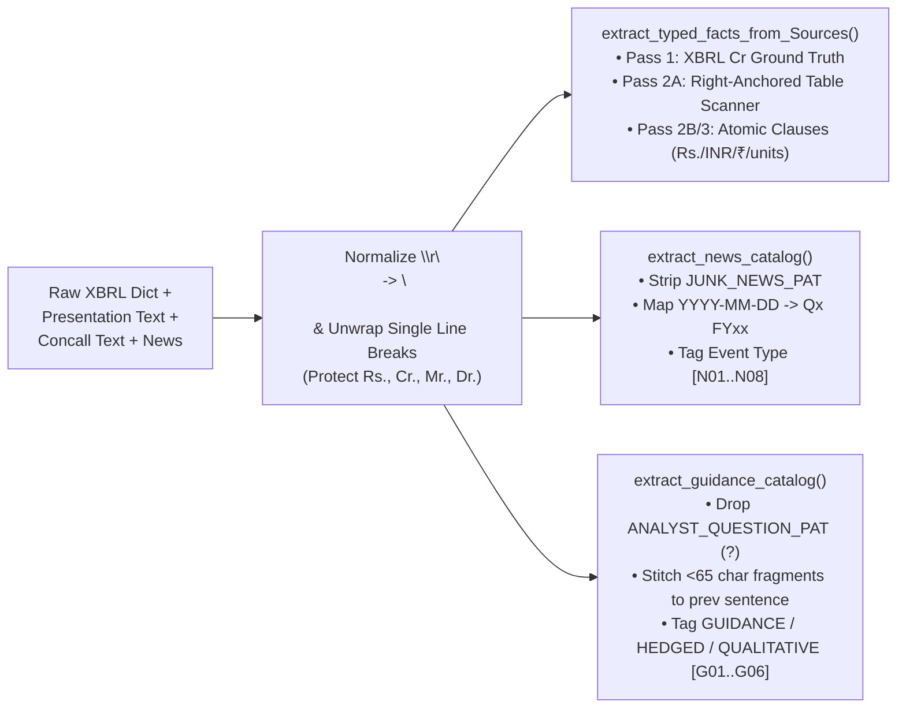
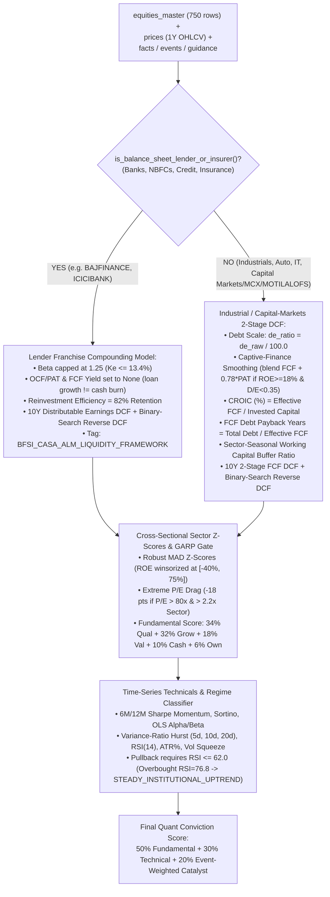
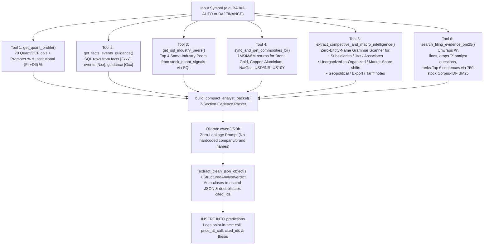

# NSE 750 Institutional Equities Engine — Complete System Architecture & Method Blueprint

## 1. Plain-English Guide to Every Package Used (And *Why* We Use It)

Before looking at individual methods, here is what each Python library in your codebase actually does under the hood, why it was chosen over alternatives, and what type of computational workload it handles:

| Package | What It Is in Plain English | Where It Is Used & What Workload It Handles |
| :--- | :--- | :--- |
| **`pydantic` (`BaseModel`, `Field`, `model_validator`, `field_validator`)** | **An automated JSON bouncer & data-type fixer.** When a small 4B or 9B LLM outputs JSON, it frequently makes formatting mistakes: it might call a key `"segments"` instead of `"segment_facts"`, output a string instead of a list (`"Steel"` instead of `["Steel"]`), wrap IDs in brackets (`["[F001]"]`), or leave trailing arrays empty. **Pydantic** defines a strict Python blueprint (`class MasterCompanyFacts(BaseModel)` and `class StructuredAnalystVerdict(BaseModel)`). When you call `.model_validate_json(raw_text)`, Pydantic automatically repairs wrong key names (`@model_validator(mode="before")`), converts strings into lists, harvests `[Fxxx]`/`[Nxx]`/`[Gxx]` citations from text, strips duplicates (`@model_validator(mode="after")`), and guarantees that the final object matches your database schema 100% of the time. | Used in `competitive_inteligence.py` (to validate and repair 4B extraction JSON) and `analyst_engine.py` (to validate and repair the 9B Analyst JSON verdict). **Workload:** Schema validation & deterministic post-processing (CPU, `< 1 ms`). |
| **`pymupdf` (`import pymupdf as fitz`)** | **A high-speed C++ PDF coordinate reader.** Standard PDF readers (`PyPDF2`, `pdfplumber`) dump text in whatever order the graphic designer drew the boxes, scrambling financial tables. PyMuPDF's `page.get_text("words")` returns the exact `(x0, y0, x1, y1, "word")` pixel coordinates of every word on a slide. By grouping words with the same vertical `y0` coordinate (`int(round(w[1] / 4.0))`) and sorting left-to-right by `x0`, we reconstruct horizontal table rows (`Retail | 8,240.22 | 9,165.12 | 9,456.87 | 14.8%`) cleanly. | Used in `competitive_inteligence.py` (`clean_investor_presentation` and `clean_concall_transcript`). **Workload:** Binary PDF parsing & 2D spatial coordinate sorting (CPU, `~0.3s` per 50-page PDF). |
| **`xml.etree.ElementTree` (`ET`)** | **Built-in XML tree parser.** NSE's XBRL financial filings and Google News RSS feeds are XML documents. `ET.fromstring(xml_bytes)` walks the XML tree to extract tags like `<RevenueFromOperations>`, `<InterestEarned>`, `<ProfitBeforeTax>`, or `<item><title>`. | Used in `competitive_inteligence.py` (`parse_nse_xbrl_bytes` and `fetch_news_rss`). **Workload:** XML tree traversal (CPU, `< 5 ms`). |
| **`httpx`** | **A modern HTTP network client with persistent sessions and timeouts.** Unlike `requests`, `httpx.Client` handles NSE's anti-bot cookie challenges, HTTP/2 connection pooling, redirects, and long 240-second timeouts when waiting for local Ollama LLM generation (`http://localhost:11434/api/chat`). | Used in `competitive_inteligence.py` and `analyst_engine.py`. **Workload:** Network I/O (NSE API downloads + local Ollama REST calls). |
| **`duckdb`** | **An in-process analytical SQL database (OLAP).** Think of DuckDB as SQLite engineered for vectorized data science: it lives in a single file (`NSE-universe-raw.duckdb`), reads/writes Pandas DataFrames directly (`conn.register` / `.df()`) with zero copy overhead, and executes complex cross-sectional SQL queries across 750 stocks in `< 5 ms`. | Used in `competitive_inteligence.py`, `quant_stats_engine.py`, and `analyst_engine.py`. **Workload:** Disk I/O & vectorized SQL queries. |
| **`numpy` & `pandas`** | **Vectorized array & table math engines.** Used in `quant_stats_engine.py` to compute cross-sectional sector medians, Robust MAD Z-scores, 2-Stage DCF present values, Binary-Search Reverse DCF, OLS regressions ($\alpha, \beta$), Variance-Ratio Hurst Exponents, and rolling volatility across all 750 stocks simultaneously. | Used in `quant_stats_engine.py` and `analyst_engine.py`. **Workload:** Vectorized linear algebra & statistical transformations (CPU, `~2.8s` for all 750 stocks). |
| **`yfinance`** | **Yahoo Finance market data downloader.** Downloads 1-year daily OHLCV bars for all 750 NSE stocks (`RELIANCE.NS`, `BAJFINANCE.NS`, etc.) plus the Nifty 50 benchmark (`^NSEI`) into the `prices` table, and 6-month daily futures/FX series (`BZ=F`, `GC=F`, `HG=F`, `ALI=F`, `NG=F`, `INR=X`, `^TNX`) into the `commodities_fx` table. | Used in `quant_stats_engine.py` (`sync_daily_prices_yfinance`) and `analyst_engine.py` (`sync_and_get_commodities_fx`). **Workload:** Multi-threaded Network I/O (cached daily in DuckDB). |
| **`re` (Regular Expressions)** | **Deterministic pattern-matching engine.** Powers the canonical metric lexicon (`METRIC_LEXICON`), right-anchored table row extraction (`TABLE_ROW_PAT`), atomic clause splitting, Windows `\r\n` PDF line-unwrapping, guidance modality tagging (`GUIDANCE` vs `HEDGED` vs `QUALITATIVE_OUTLOOK`), and zero-leakage structural grammar scanning. | Used across all 4 modules. **Workload:** String tokenization & pattern matching (CPU, `< 10 ms` per stock). |
| **`yaml` (`PyYAML`) & `tqdm`** | **Configuration loader & progress bar.** `yaml.safe_load()` reads `config.yaml` (database paths, Ollama model names) and `skills.yaml` (sector archetype rules). `tqdm` renders live terminal progress bars with ETA during batch downloads. | Used across all modules. **Workload:** Config parsing (`< 1 ms`). |

---

## 2. End-to-End Master System Flowchart

A critical architectural rule of this system: **`quant_stats_engine.py` does NOT call any LLM or use any prompt.** It is 100% deterministic math. It writes 70 statistical, DCF, CROIC, debt-payback, seasonal working-capital, and technical columns into the `stock_quant_signals` DuckDB table, which `analyst_engine.py` then reads via SQL and injects into **Section 1 of the Analyst Prompt**.

```mermaid
flowchart TD
    subgraph STAGE1["STAGE 1: Ingestion & Extract-Then-Bind (competitive_inteligence.py + normalizer.py)"]
        NSE["NSE APIs & Google News RSS\n(XBRL XML + Investor Deck PDF + Concall PDF + News)"]
        CLEAN["DeterministicFinancialExtractor\n• parse_nse_xbrl_bytes() -> XBRL Cr dict\n• clean_investor_presentation() -> (y0,x0) pipe rows\n• clean_concall_transcript() -> top scored paragraphs"]
        NORM["normalizer.py (100% Deterministic Python)\n• Unwraps Windows \\r\\n PDF line breaks\n• extract_typed_facts_from_Sources() -> [F001..F045]\n• extract_news_catalog() -> [N01..N08]\n• extract_guidance_catalog() -> [G01..G06] (GUIDANCE / HEDGED / QUALITATIVE)"]
        LLM4B["Ollama: nemotron-3-nano:4b\n(Extractor Prompt in skills.yaml)\nPicks fact_id ('F015'), news_id ('N01') & writes reported_driver"]
        BIND["Pydantic + bind_and_ground_facts()\n• Repairs JSON schema via MasterCompanyFacts\n• Overwrites segment numbers/units/dates from [Fxxx] & [Nxx]"]
        NSE --> CLEAN --> NORM --> LLM4B --> BIND
    end

    subgraph DB["DUCKDB STORAGE (NSE-universe-raw.duckdb)"]
        T_CI[("company_intelligence\n(750 rows)")]
        T_FEG[("Point-in-Time Tables:\n• facts (2,754 rows / 750 stocks)\n• events (5,930 rows / 750 stocks)\n• guidance (2,032 rows / 578 stocks)")]
        T_EM[("equities_master (750 rows)\n• Fundamentals + Insider/Inst %\n• prices (1Y Daily OHLCV)\n• commodities_fx (7 Macro Series)")]
        T_QUANT[("stock_quant_signals\n(750 rows x 70 Quant, DCF, CROIC,\nDebt Payback & Tech Columns)")]
        T_PRED[("predictions\n(Point-in-Time Logged Calls)")]
    end

    BIND --> T_CI
    BIND --> T_FEG

    subgraph STAGE2["STAGE 2: Quantitative, DCF & Cash-Flow Engine (quant_stats_engine.py — ZERO LLM)"]
        SYNC_P["sync_point_in_time_tables_from_cache()\nMerges Tier 1 (Normalizer) + Tier 2 (JSON) + Tier 3 (TTM Master)"]
        ROUTE["is_balance_sheet_lender_or_insurer()\nRoutes Banks/NBFCs vs Capital Markets/Exchanges vs Industrials"]
        DCF["compute_dcf_and_cash_sustainability()\n• CAPM Cost of Equity (Ke)\n• CROIC (%) & Captive-Finance OCF Smoothing\n• FCF-to-Debt Payback Horizon (de_raw / 100.0)\n• Sector-Seasonal Working Capital Buffer\n• 2-Stage 10Y FCF DCF / Lender Franchise Compounding\n• Binary-Search Reverse DCF Implied 5Y Growth"]
        ZSCORE["Cross-Sectional Sector Z-Scores\n• Median/MAD Robust Z-Scores by Sector\n• GARP Valuation Drag (P/E > 80x & > 2.2x Sector)\n• Balanced Composite: 34% Qual + 32% Grow + 18% Val + 10% Cash + 6% Own"]
        TECH["compute_single_ticker_technicals()\n• 1M/3M/6M/12M Sharpe Momentum & Sortino\n• OLS Alpha & Beta vs Nifty 50 (^NSEI)\n• RSI(14), ATR%, Volatility Squeeze, Variance-Ratio Hurst, CVaR(95%)"]
        T_CI & T_EM --> SYNC_P --> ROUTE --> DCF --> ZSCORE --> TECH --> T_QUANT
    end

    subgraph STAGE3["STAGE 3: Tool-Calling Analyst & Prediction Logger (analyst_engine.py)"]
        TOOLS["EquitiesAnalystTools (100% Deterministic SQL + BM25)\n1. get_quant_profile() -> 70 Quant/DCF cols + Promoter/FII+DII %\n2. get_facts_events_guidance() -> [Fxxx], [Nxx], [Gxx]\n3. get_sql_industry_peers() -> Top 4 Same-Industry Peers via SQL\n4. sync_and_get_commodities_fx() -> Live Brent, Gold, Copper, Alu, USD/INR\n5. extract_competitive_and_macro_intelligence() -> Zero-Leakage Grammar\n6. search_filing_evidence_bm25() -> Top 6 Corpus-IDF Unwrapped Sentences"]
        PACKET["build_compact_analyst_packet()\nAssembles 7-Section Evidence Packet (Facts First, Rules Last)"]
        LLM9B["Ollama: qwen3.5:9b (format='json', num_predict=2200)\n+ Auto-Closing JSON Repair + Pydantic StructuredAnalystVerdict"]
        T_QUANT & T_FEG & T_CI & T_EM --> TOOLS --> PACKET --> LLM9B --> T_PRED
    end
```



---

## 3. Module-by-Module & Method-by-Method Breakdown

### Module 1: `normalizer.py` (Deterministic Fact, News & Guidance Extractor)
**Purpose:** Prevents the 4B LLM from misreading table columns, losing slide unit headers (`₹ billion` vs `₹ crore`), chopping PDF lines across Windows `\r\n` breaks, or confusing analyst questions with management guidance. **Workload:** Pure Python regular expressions (`re`) and string parsing (`~10 ms` per company).



| Method Name | Input $\rightarrow$ Output | Exact Mechanism & Why It Exists |
| :--- | :--- | :--- |
| `classify_metric_label(row_label, slide_heading)` | `(str, str) -> str` | Scans `row_label` first, then `slide_heading`, against `METRIC_LEXICON` (23 canonical regex rules). If a slide is titled `"Loan portfolio"` (`ICICIBANK` Slide 15), every row (`Retail`, `Business banking`, `Domestic corporate`) inherits `"Loan Book (Advances)"` so the LLM can never call loans `"Revenue"`. |
| `date_to_indian_fiscal_quarter(date_str)` | `"2026-10-17" -> "Q3 FY27"` | Converts `YYYY-MM-DD` into the Indian Fiscal Calendar (`Apr–Jun = Q1`, `Jul–Sep = Q2`, `Oct–Dec = Q3`, `Jan–Mar = Q4`) so the LLM never guesses fiscal quarters. |
| `detect_slide_unit_scope(slide_text)` | `str -> "₹ bn" \| "₹ Cr" \| "US$ Mn"` | Scans the top 450 characters of a slide for parenthesized unit captions like `(₹ billion)` or `(US$ Million)` using pure ASCII Unicode escapes (`\u20b9`, `\u20ac` so Windows PowerShell never corrupts them) and locks that unit to every cell on the slide. |
| `split_into_atomic_clauses(text)` | `str -> List[str]` | Normalizes Windows `\r\n` to `\n`, unwraps single-line PDF wraps (`(?<!\n)\n(?!\n)`) so sentences aren't chopped mid-line, splits bullets and numbered concall remarks (`1. NII grew... 2. NIM was...`), and filters out analyst questions (`ANALYST_QUESTION_PAT`). |
| `extract_typed_facts_from_Sources(xbrl_dict, pres_text, trans_text)` | `(dict, str, str) -> List[Dict]` | Builds `[F001..F045]`:<br>1. **Pass 1 (XBRL):** Locks ground-truth consolidated Revenue, NII, PBT, and PAT in Crores.<br>2. **Pass 2A (Right-Anchored Table Scanner):** Uses `TABLE_ROW_PAT` to parse pipe-separated rows (`Label \| v1 \| v2 \| v3 \| p1% \| p2%`). Selects the **rightmost value column (`v3 or v2`)** as the latest period, converts `₹ bn` $\rightarrow$ `₹ Cr` (`× 100`), and marks parenthesized numbers `(86.3)` as `"Negative / Loss (86.3)"`.<br>3. **Pass 2B & 3 (Atomic Clauses):** Uses `ATOMIC_FACT_CLAUSE_PAT` to match `₹`, `Rs.`, `INR`, physical volumes (`lakh units`, `units`), and verbs (`grew by`, `delivered`, `clocked`, `reported`, `crossed`, `jumped`). |
| `extract_news_catalog(news_text)` | `str -> List[Dict]` | Filters out stock-price spam (`JUNK_NEWS_PAT`) and numbers valid headlines `[N01..N08]` with deterministic `event_type` (`ORDER_BOOK`, `CAPEX`, `PARTNERSHIP_JV`, `PRICING_ACTION`, `POLICY_REGULATION`, `RISK_FACTOR`, `OPERATIONAL_MILESTONE`). |
| `extract_guidance_catalog(pres_text, trans_text, doc_period)` | `(str, str, str) -> List[Dict]` | Normalizes `\r\n`, unwraps PDF lines while protecting abbreviations (`Rs.`, `Cr.`, `Mr.`, `Dr.`), drops analyst questions (`?`), **stitches short `< 65` char fragments (like `"our guidance of 16% to 18%."`) to their preceding sentence**, requires a real metric noun (`metric_anchor_pat`), and tags each `[G01..G06]` statement as `HEDGED`, `GUIDANCE` (numerical), or `QUALITATIVE_OUTLOOK`. |

---

### Module 2: `competitive_inteligence.py` (NSE Scraper, PDF Cleaner & Extract-Then-Bind Pipeline)
**Purpose:** Downloads filings from NSE, cleans PDFs via 2D word coordinates, runs `nemotron-3-nano:4b` to select `[Fxxx]`/`[Nxx]` IDs and write qualitative drivers, validates/repairs output with **Pydantic**, and binds the exact deterministic strings into DuckDB.

| Method Name | Type of Work | Detailed Step-by-Step Logic |
| :--- | :--- | :--- |
| `SegmentFact`, `ExtractedCatalyst`, `MasterCompanyFacts` (**Pydantic Models**) | Schema Validation & Auto-Repair (CPU) | When `nemotron-3-nano:4b` returns JSON, `MasterCompanyFacts.model_validate_json(raw_text)` runs:<br>1. `normalize_keys_and_types` (`mode="before"`): Maps aliases like `"segments"` $\rightarrow$ `"segment_facts"` or `"catalysts"` $\rightarrow$ `"key_catalysts_and_events"`, coerces strings/dicts into lists, and strips placeholder strings like `"none"` or `"n/a"`.<br>2. `clean_and_deduplicate_post` (`mode="after"`): Removes short unit strings (`"₹ Cr"`) or stock-price headlines from `raw_materials_and_macro_sensitivities`. |
| `DeterministicFinancialExtractor.parse_nse_xbrl_bytes(xml_bytes)` | XML Parsing (CPU) | Parses NSE's XBRL `.xml` filing. Captures global `DateOfEndOfReportingPeriod` across contexts, converts raw rupees ($\ge 10^7$) into Crores (`/ 1e7`), prioritizes the current quarterly duration context (`"OneD"`), and computes `Derived_PAT_Margin_Pct`. |
| `DeterministicFinancialExtractor.clean_investor_presentation(pdf_bytes)` | 2D PDF Coordinate Reconstruction (CPU) | Opens the PDF with `fitz.open()`, extracts `(x0, y0, word)` tuples via `page.get_text("words")`, groups words into horizontal lines by `y_bucket = int(round(y0 / 4.0))`, inserts `" \| "` whenever horizontal gap `x0 - prev_x > 35pt`, removes repeating header/footer lines, scores slides by financial keyword + number density, **selects top slides up to `6,000` chars by score first**, and sorts selected slides by slide number. |
| `call_local_llm(...)` | Prompt Assembly + Local LLM Inference (GPU/CPU) | 1. Calls `normalizer.py` to build `typed_fact_catalog` (`[F001..F045]`), `news_catalog` (`[N01..N08]`), and `guidance_catalog` (`[G01..G06]`).<br>2. Resolves top 1–2 sector archetypes from `skills.yaml` (v3).<br>3. Sends prompt to `nemotron-3-nano:4b` via Ollama (`format="json"`, `temperature=0.0`).<br>4. Validates via Pydantic and calls `bind_and_ground_facts()`. |
| `bind_and_ground_facts(...)` | Deterministic Fact & News Binding (CPU) | **The Core Accuracy Guarantee:**<br>• Looks up each `seg.fact_id` (`"F015"`) in `typed_facts` and overwrites `seg.segment_name` and `seg.financial_performance` with the exact Python-formatted string (`"[F015] Loan Book (Advances): ₹9,456.87 bn (₹945,687.0 Cr) (14.8% YoY...)"`).<br>• Looks up each `ev.news_id` (`"N01"`) in `news_items` and overwrites `ev.event_type`, `ev.description`, and `ev.timeline` (`"[2026-10-17]"`).<br>• Strips internal subsidiaries (`BCCL`, `SECL`, `Jio`, `VECV`) from `explicitly_named_competitors`. |

---

### Module 3: `quant_stats_engine.py` (DCF, Cash Runway, Debt Payback, Fundamental & Technical Engine)
**Purpose:** Computes 70 institutional quantitative features across all 750 stocks in ~2.8 seconds using pure Python/NumPy/Pandas/DuckDB (**zero LLM calls**).



#### Detailed Mathematical Formulas Inside `quant_stats_engine.py`

1. **Balance-Sheet Lender vs. Capital-Markets Taxonomy (`is_balance_sheet_lender_or_insurer`):**
   * `yfinance` groups Exchanges (`MCX`, `BSE`), Brokers (`MOTILALOFS`, `GROWW`), and AMCs (`HDFCAMC`) under `Sector = "Financial Services"`.
   * `is_balance_sheet_lender_or_insurer()` explicitly routes `exchange`, `financial data`, `asset management`, `capital market`, and `broking` to the **Asset-Light Free-Cash-Flow DCF**, while routing `bank`, `credit`, `nbfc`, `housing finance`, and `insurance` to the **Lender Franchise Compounding Model**.

2. **CAPM Cost of Equity ($K_e$):**
   Uses the Indian 10-Year G-Sec risk-free rate ($R_f = 6.85\%$) and India Equity Risk Premium ($\text{ERP} = 5.25\%$):
   $$K_e = \text{clip}\left(6.85\% + \beta_{\text{clamped}} \times 5.25\%, \; 10.5\%, \; 15.5\%\right)$$
   *(For regulated Banks/NBFCs, $\beta_{\text{clamped}}$ is capped at `1.25` so short-term market beta spikes do not push $K_e > 13.41\%$.)*

3. **Debt Scale & Captive-Finance CROIC Smoothing:**
   * **Debt Reconstruction:** `yfinance` reports `debt_to_equity` in percentage points (`0.7` = `0.7%` = `0.007x` for `BAJAJ-AUTO`). Python converts `de_ratio = max(de_raw / 100.0, 0.0)`:
     $$\text{Book Equity} = \frac{\text{Market Cap}}{P/B}, \qquad \text{Total Debt} = \text{Book Equity} \times \text{de\_ratio}, \qquad \text{Invested Capital} = \text{Book Equity} + \text{Total Debt}$$
   * **Captive-Finance OCF/FCF Smoothing:** Auto and Industrial leaders with captive NBFC subsidiaries (`BAJAJ-AUTO` via *Bajaj Auto Credit*, `M&M` via *MMFSL*) record customer loan disbursements as Consolidated Operating Cash Outflows, artificially depressing Yahoo Finance's consolidated `free_cash_flow`. When a non-lender has $\text{ROE} \ge 18\%$, $\text{de\_ratio} < 0.35$, and reported $\text{FCF} < 0.45 \times \text{Implied PAT}$, Python smooths `effective_fcf`:
     $$\text{Effective FCF} = 0.50 \times \text{Reported FCF} + 0.50 \times (0.78 \times \text{Implied PAT})$$
   * **CROIC & Debt Payback Years:**
     $$\text{CROIC (\%)} = \frac{\text{Effective FCF}}{\text{Invested Capital}} \times 100, \qquad \text{FCF Debt Payback (Years)} = \frac{\text{Total Debt}}{\text{Effective FCF}}$$

4. **Sector-Seasonal Working Capital Buffer (`seasonal_wc_buffer_ratio` & `sector_seasonal_cycle_tag`):**
   Uses strict regex word boundaries (`\b`) so `"Credit Services"` never matches `"it services"`:
   * `CAPITAL_MARKETS_ASSET_LIGHT_FEE_ENGINE` (`Min CR = 1.15`, `Min QR = 1.00`)
   * `BFSI_CASA_ALM_LIQUIDITY_FRAMEWORK` (`Min CR = 1.00`, `Min QR = 1.00`)
   * `AUTO_H1_CAPEX_M&A_Q3_Q4_FESTIVE_HARVEST` (`Min CR = 1.35`, `Min QR = 0.90` — H1 capex/M&A & dealer stocking vs. Q3/Q4 festive cash harvest)
   * `EPC_H1_WORKING_CAPITAL_LOCK_Q4_GOVT_BILLING_RELEASE` (`Min CR = 1.50`, `Min QR = 1.05`)
   * `AGRI_MONSOON_INVENTORY_BUILD_SUBSIDY_LAG` (`Min CR = 1.45`, `Min QR = 0.85`)
   * `CONSUMER_Q2_INVENTORY_STOCKING_Q3_DIWALI_CASH_RELEASE` (`Min CR = 1.35`, `Min QR = 0.75`)
   * `ASSET_LIGHT_NEGATIVE_WC_STEADY_CASH_CYCLE` (`Min CR = 1.15`, `Min QR = 0.95`)
   * `PHARMA_CHEM_USFDA_EXPORT_RECEIVABLE_CYCLE` (`Min CR = 1.40`, `Min QR = 1.00`)
   $$\text{Seasonal WC Buffer Ratio} = 0.55 \left(\frac{\text{Quick Ratio}}{\text{Sector Min QR}}\right) + 0.45 \left(\frac{\text{Current Ratio}}{\text{Sector Min CR}}\right)$$

5. **2-Stage 10-Year DCF & Binary-Search Reverse DCF (`dcf_intrinsic_value` & `reverse_dcf_implied_growth_pct`):**
   * **For Industrials, Auto, IT & Capital Markets:** Projects normalized cash flow growing at $g_1 = \text{clip}(0.65 \cdot g_{\text{hist}} + 0.35 \cdot \text{CROIC} \cdot 0.85, \; 6\%, \; 26\%)$ for Years 1–5 (capped at $8\%$ if $P/E < 7.5\times$ to prevent peak-cycle shipping/refinery traps), linearly fading to $g_{\text{term}} = 6.5\%$ in Years 6–10, plus Terminal Value $\frac{\text{CF}_{10}(1 + g_{\text{term}})}{K_e - g_{\text{term}}}$, discounted at $K_e$.
   * **For Balance-Sheet Lenders (`BAJFINANCE`, `ICICIBANK`):** Uses a 2-Stage Distributable Equity Earnings model where base distributable earnings capacity is $\text{PAT} \times \left(1 - \frac{g_{\text{term}}}{\text{ROE}}\right)$, compounded over 10 years at $g_1$ fading to $g_{\text{term}}$.
   * **Binary-Search Reverse DCF (22 Iterations):** Solves for the exact 5-year growth rate $g_{\text{implied}} \in [-15\%, +48\%]$ where $\text{PV}(g_{\text{implied}}) = \text{Current Market Price}$.

---

### Module 4: `analyst_engine.py` (SQL Tool Router, Live Macro/Commodity Context, Zero-Leakage Competitive Scanner & Prediction Logger)
**Purpose:** Assembles a 100% grounded, 7-section Evidence Packet from DuckDB and passes it to `qwen3.5:9b` (`format="json"`, `num_predict=2200`) with automatic JSON bracket-closing repair and point-in-time prediction logging.



#### How Section 7 (Macro, Commodities, Ownership, Subsidiaries, Peers & Unorganized Sector) Works Without Prompt Leakage

| Signal Category | Where the Data Comes From | How It Avoids Prompt Leakage |
| :--- | :--- | :--- |
| **1. Live Commodity & FX Prices** | Downloaded once daily via `yfinance` into the `commodities_fx` DuckDB table (`BZ=F` Brent, `GC=F` Gold, `HG=F` Copper, `ALI=F` Aluminium, `NG=F` NatGas, `INR=X` USD/INR, `^TNX` US 10Y) with exact 1M, 3M, and 6M returns. | Mapped to the stock's sector via `SECTOR_COMMODITY_LINKS` in Python before the LLM is called. |
| **2. Promoter & Institutional (FII + DII) Holding %** | Pulled via SQL `LEFT JOIN equities_master em ON sq.ticker = em.ticker` (`held_by_insiders * 100` and `held_by_institutions * 100`). | Injected deterministically into Section 1 (`Promoter/Insider Holding=61.0% \| Institutional (FII + DII) Holding=16.7%`). |
| **3. Direct Industry Peers** | Queried dynamically via SQL (`get_sql_industry_peers`) from `stock_quant_signals WHERE UPPER(industry) = UPPER(?) ORDER BY market_cap_rank ASC LIMIT 4`. | Never hardcoded; dynamically pulls the actual NSE peers for that exact industry (`MARUTI`, `M&M`, `TVSMOTOR`, `EICHERMOT` for Auto; `CHOLAFIN`, `SHRIRAMFIN`, `BAJAJFINSV` for Credit Services). |
| **4. Subsidiaries, JVs & Associates** | Scanned from the company's unwrapped filing text using pure legal structure terms: `subsidiar(y\|ies)`, `joint venture`, `\bjv\b`, `wholly-owned`, `associate compan`, `step-down`, `stake in`, `acquires?`, `merger`, `demerger`. | Contains **zero** hardcoded brand/company names (`ktm`, `chetak`, `bhfl` were completely removed). |
| **5. Unorganized / Informal Sector & Market Share** | Scanned from the company's unwrapped filing text using generic economic terms: `unorgani[sz]ed`, `informal sector`, `organi[sz]ed players`, `market share`, `regional players`, `fragmented`, `gst`, `bis norms`, `shift from`. | Surfaces only what the company's own management stated about market-share gains or informal competition. |

---

## 4. Exact Zero-Leakage Prompt Sent to `qwen3.5:9b` in `analyst_engine.py`

```text
You are a Senior Institutional Quant & Fundamental Equity Analyst covering the NSE 750 universe.
Analyze the deterministic Evidence Packet below for {company_name} ({symbol}) and answer: "{user_query}"

=== 1. QUANTITATIVE, DCF, CASH-RUNWAY & OWNERSHIP PROFILE: {company_name} (NSE: {symbol}) ===
- Market Cap Rank: #{market_cap_rank} (₹{market_cap_cr} Cr | {market_cap_category}) | Sector: {sector} ({industry})
- Current Price: ₹{current_price} | Signal Tag: {quant_signal_tag} | Overall Quant Conviction: {quant_conviction_score} / 100
- Factor Scores (0-100): Fundamental={fundamental_composite_score} (Quality={quality_percentile}%, Growth={growth_percentile}%, Cash Sustainability={cash_sustainability_percentile}%, Value={value_percentile}%, Ownership={ownership_percentile}%) | Technical={technical_composite_score} | Filing/Catalyst={filing_catalyst_score}
- Shareholding & Institutional Interest: Promoter/Insider Holding={promoter_holding_pct}% | Institutional (FII + DII) Holding={fii_dii_institutional_pct}% (Ownership Percentile={ownership_percentile}%)
- DCF & Cash-Flow Sustainability: DCF Intrinsic Value=₹{dcf_intrinsic_value} (Margin of Safety={dcf_margin_of_safety_pct}%) | Reverse DCF Implied 5Y Growth={reverse_dcf_implied_growth_pct}% (Growth Cushion={dcf_growth_cushion_pct}%) | CAPM Cost of Equity (Ke)={cost_of_equity_ke_pct}% | CROIC={croic_pct}% | Reinvestment/Retention Efficiency={reinvestment_efficiency_pct}% | FCF Debt Payback={fcf_to_debt_payback_years} Years | Seasonal WC Buffer={seasonal_wc_buffer_ratio}x ({sector_seasonal_cycle_tag}) | Cash Regime={cash_debt_regime_tag}
- Valuation vs Sector: P/E={pe_ratio}x (Forward P/E={forward_pe}x, Sector Median={sector_pe_median}x) | P/B={pb_ratio}x (Sector={sector_pb_median}x) | EV/EBITDA={ev_to_ebitda}x | FCF Yield={fcf_yield_pct}% | Valuation Sector Z-Score={val_zscore_sector}
- Profitability & Balance Sheet: ROE={roe_pct}% (Sector Median={sector_roe_median}%, Z={roe_zscore_sector}) | ROA={roa_pct}% | Operating Margin={operating_margin_pct}% | Net Profit Margin={net_profit_margin_pct}% | Debt/Equity={debt_to_equity}% | OCF/PAT={ocf_to_pat_ratio}x
- Growth Rates: TTM Revenue Growth={revenue_growth_pct}% | Earnings Growth={earnings_growth_pct}% | Median Filing YoY Growth={extracted_yoy_growth_median_pct}%
- Technical & Risk Stats: Regime={technical_regime} | Returns: 1M={ret_1m_pct}%, 3M={ret_3m_pct}%, 6M={ret_6m_pct}%, 12M={ret_12m_pct}% | 6M Sharpe Momentum={sharpe_momentum_6m} | Sortino(1Y)={sortino_ratio_1y} | OLS Alpha(1Y)={alpha_252d_ann_pct}% | Beta={beta_252d} | RSI(14)={rsi_14} | Vol Squeeze Pct={vol_squeeze_percentile}% | Up/Down Vol Ratio(20D)={up_down_vol_ratio_20d} | Hurst(126D)={hurst_exponent_126d} | Dist 50DMA={dist_from_50dma_pct}% | Dist 200DMA={dist_from_200dma_pct}% | Dist 52W High={dist_from_52w_high_pct}% | Max DD(1Y)={max_drawdown_1y_pct}% | 95% Daily CVaR={cvar_95_daily_pct}%

=== 2. DETERMINISTIC FILING FACTS ([Fxxx]) ===
  [F001..F015 rows from `facts` table]

=== 3. REPORTED SEGMENT DRIVERS ===
  [Segment drivers from `company_intelligence`]

=== 4. RECENT CORPORATE EVENTS & NEWS ([Nxx]) ===
  [N01..N08 rows from `events` table]

=== 5. MODALITY-TAGGED MANAGEMENT GUIDANCE ([Gxx]) ===
  [G01..G06 rows from `guidance` table]

=== 6. BM25 RETRIEVED FILING EVIDENCE SNIPPETS ===
  [Top 6 unwrapped, question-filtered Corpus-IDF BM25 sentences from Deck & Concall]

=== 7. MACRO, COMMODITY/FX, SUBSIDIARY & COMPETITIVE CONTEXT ===
- Live Sector Commodity & FX Benchmarks: [1M/3M/6M returns from `commodities_fx`]
- Sector Macro & Input Sensitivities: [Sensitivities]
- Same-Industry Quantitative Peer Benchmarks: [Top 4 SQL Peers with Rank, P/E, P/B, ROE, CROIC, Conviction]
- Filing Subsidiary / JV / Associate Mentions: [Unwrapped filing sentences]
- Filing Market-Share / Unorganized-to-Organized Shift Mentions: [Unwrapped filing sentences]
- Filing Geopolitical / Export / Regulatory Mentions: [Unwrapped filing sentences]

MANDATORY ANALYST RULES (ZERO HALLUCINATION & ZERO LEAKAGE):
1. GROUNDED NUMBERS ONLY: Never invent or recalculate numbers. Cite exact figures from Section 1 and cite [Fxxx], [Nxx], and [Gxx] IDs from Sections 2-5.
2. MACRO, SUBSIDIARIES, INSTITUTIONAL OWNERSHIP & INFORMAL COMPETITION: In `macro_geopolitical_and_competitive_view`, evaluate Commodity/FX trends, Promoter & Institutional (FII + DII) ownership, subsidiary/JV contributions, unorganized-to-organized market-share shifts, and peer valuation comparison.
3. CONCISE DENSITY & COMPLETE ARRAYS: Keep each text field to 2-3 tight, high-signal sentences (max 65 words per field) so the JSON completes cleanly. Populate `key_risks` with 2-4 specific risks and list every cited ID in `cited_ids`.
```

---

## 5. Ledger of the 6 Institutional Audit Fixes Applied

1. **Debt/Equity Percentage Scale Normalization (`quant_stats_engine.py`):** Fixed `de_ratio = max(de_raw / 100.0, 0.0)` because `yfinance` reports `debt_to_equity` in percentage points (`0.7` = `0.7%` = `0.007x`). This eliminated the phantom `18.5 Years Debt Payback` on `BAJAJ-AUTO` (`0.0 Years`).
2. **Captive-Finance Consolidated OCF/FCF Smoothing (`quant_stats_engine.py`):** High-ROE, low-debt manufacturers with captive NBFC arms (`BAJAJ-AUTO`, `M&M`) record customer loan originations as negative consolidated Operating Cash Flow. Blending `50% Reported FCF + 50% (0.78 * Implied PAT)` when `ROE >= 18%` and `de_ratio < 0.35` restored `BAJAJ-AUTO`'s `CROIC` from `2.2%` to `15.6%` (`HEALTHY_INTERNAL_ACCRUALS`).
3. **Balance-Sheet Lender vs. Capital-Markets Routing (`quant_stats_engine.py`):** Separated Exchanges/AMCs/Brokers (`MCX`, `MOTILALOFS`, `GROWW`) from Banks/NBFCs (`BAJFINANCE`, `ICICIBANK`), and built the 10-Year Distributable Equity Earnings model for Lenders (`BAJFINANCE` DCF Intrinsic Value = `₹883.6` instead of `₹305.6`).
4. **Windows `\r\n` PDF Line-Unwrapping (`normalizer.py` & `analyst_engine.py`):** Normalized `\r\n` $\rightarrow$ `\n` before unwrapping single line breaks (`(?<!\n)\n(?!\n)`), stopping concall sentences and guidance from being chopped mid-clause.
5. **Analyst Question Filtering in BM25 (`analyst_engine.py`):** Added `q_filter` (`?`, `how do you see`, `how do you think`) to `search_filing_evidence_bm25()` so analyst questions are never cited as management facts.
6. **Overbought RSI Guard on Pullback Regime & Citation Deduplication (`quant_stats_engine.py` & `analyst_engine.py`):** Restricted `UPTREND_PULLBACK_ACCUMULATE` to `rsi <= 62.0` (so `RSI = 76.8` is classified as `STEADY_INSTITUTIONAL_UPTREND`), and stripped brackets `[]` from `cited_ids` (`["F001", "F002", "N01", ...]`).

---

## 6. Decision Tuning Cheat Sheet (Where You Can Tweak Parameters)

| What You Want to Adjust | File & Function | Variable / Line to Tweak |
| :--- | :--- | :--- |
| **Change Risk-Free Rate ($R_f$) or Equity Risk Premium ($\text{ERP}$) in DCF** | `quant_stats_engine.py` $\rightarrow$ `compute_dcf_and_cash_sustainability()` | `ke_dec = float(np.clip(0.0685 + beta_clamped * 0.0525, 0.105, 0.155))` and `g_term = 0.065` |
| **Change Sector Seasonal Working-Capital Minimums** | `quant_stats_engine.py` $\rightarrow$ `SECTOR_SEASONAL_REQUIREMENTS` | Adjust `(min_cr, min_qr)` tuples per sector (e.g. `1.35, 0.90` for Auto; `1.50, 1.05` for Infra/EPC). |
| **Change Fundamental Factor Weights (Quality vs. Growth vs. Value vs. Cash)** | `quant_stats_engine.py` $\rightarrow$ `build_quant_feature_store()` | `0.34 * quality + 0.32 * growth + 0.18 * value + 0.10 * cash_sustainability + 0.06 * ownership` |
| **Change Overall Conviction Weights (Fundamental vs. Technical vs. Catalyst)** | `quant_stats_engine.py` $\rightarrow$ `build_quant_feature_store()` | `0.50 * fundamental_composite_score + 0.30 * technical_composite_score + 0.20 * filing_catalyst_score` |
| **Change P/E GARP Penalty Threshold** | `quant_stats_engine.py` $\rightarrow$ `build_quant_feature_store()` | `extreme_pe_drag` (`pe_ratio > 80.0` and `> 2.2 * sector_pe_median`). |